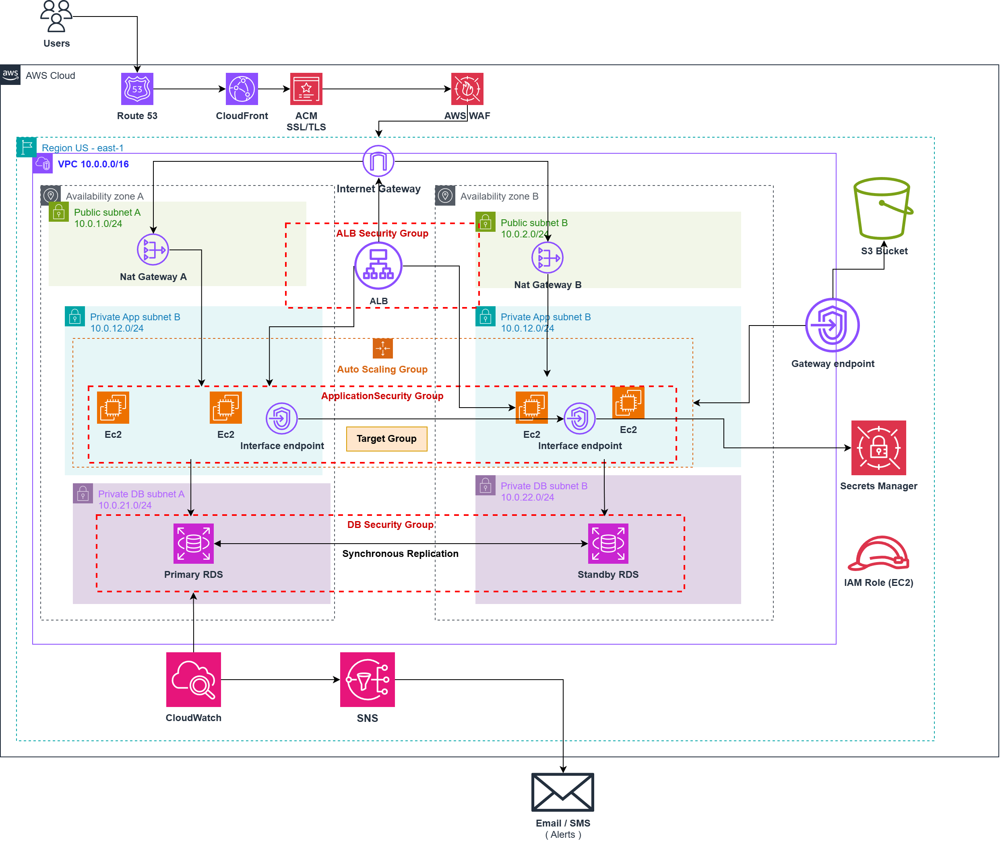

# AWS Highly Available 3-Tier Architecture Using Terraform

Infrastructure as Code (IaC) project that provisions a modular AWS architecture using Terraform, focusing on network isolation, application availability, security controls, centralized monitoring, and infrastructure automation.

The project demonstrates how core AWS services can be integrated into a reusable infrastructure design while applying cloud architecture principles and Infrastructure as Code best practices.

## Project Overview

This project provisions a three-tier application environment on AWS, with public-facing entry points, private application instances, and a private relational database.

Terraform modules are used to separate infrastructure components, improve maintainability, and make the configuration easier to understand and extend.

### Key Objectives

- Build a modular AWS infrastructure using Terraform.
- Deploy an application across multiple Availability Zones.
- Isolate application and database resources in private subnets.
- Distribute incoming application traffic through an Application Load Balancer.
- Use Auto Scaling to manage application capacity.
- Integrate CloudFront and AWS WAF for edge delivery and application-layer protection.
- Implement database encryption and private connectivity.
- Configure monitoring, alarms, and notification infrastructure.
- Apply security controls using Security Groups and IAM.
- Practice infrastructure provisioning, validation, testing, and cleanup.

## Architecture




## AWS Services Used

| Service | Purpose |
|---|---|
| Amazon VPC | Provides network isolation for the infrastructure. |
| Public and Private Subnets | Separate internet-facing resources from application and database tiers. |
| Internet Gateway | Provides internet connectivity for resources using public routing. |
| NAT Gateway | Optional outbound internet connectivity for private resources. |
| Security Groups | Control traffic between the load balancer, application instances, and database. |
| Application Load Balancer | Distributes incoming application traffic across registered targets. |
| Amazon EC2 | Hosts the sample Nginx application. |
| EC2 Auto Scaling | Maintains and adjusts application instance capacity. |
| Amazon RDS for MySQL | Provides a managed relational database in private subnets. |
| AWS Secrets Manager | Stores the RDS-managed master credentials. |
| AWS IAM | Provides an instance role and instance profile for EC2. |
| Amazon S3 | Stores objects in a private bucket with versioning and encryption. |
| VPC Gateway Endpoint (S3) | Enables private, secure communication to Amazon S3 without traversing the internet. |
| Amazon CloudFront | Provides an edge distribution for application and static-content requests. |
| AWS WAF | Applies managed rule groups and rate-based request filtering at the CloudFront distribution. |
| Amazon CloudWatch | Provides monitoring, alarms, metrics, and a dashboard. |
| Amazon SNS | Provides the notification infrastructure for monitoring alerts. |
| Terraform | Provisions and manages the infrastructure as code. |

## Network Design

The infrastructure uses a VPC with a CIDR block of `10.0.0.0/16` across two Availability Zones.

| Tier | Subnet CIDR | Intended Purpose |
|---|---|---|
| Public | `10.0.1.0/24` | Public-facing infrastructure, including the ALB. |
| Public | `10.0.2.0/24` | Public-facing infrastructure in the second AZ. |
| Private Application | `10.0.11.0/24` | Application instances in the first AZ. |
| Private Application | `10.0.12.0/24` | Application instances in the second AZ. |
| Private Database | `10.0.21.0/24` | Database subnet in the first AZ. |
| Private Database | `10.0.22.0/24` | Database subnet in the second AZ. |

### Network Security

- The ALB is placed in public subnets.
- Application instances are placed in private subnets.
- The database is configured as non-publicly accessible.
- Application traffic is permitted from the ALB Security Group.
- Database traffic is restricted to the application Security Group on MySQL port `3306`.
- The ALB and application tiers use separate Security Groups.
- NAT Gateway deployment can be controlled through a Terraform variable.

For production deployments, a NAT Gateway per Availability Zone is generally preferred when private workloads require outbound internet access, because it reduces cross-AZ dependency and improves resilience. This comes with additional cost.

## Application Tier

The application tier uses an EC2 Launch Template and Auto Scaling Group.

The current configuration uses:

- Amazon Linux 2023.
- `t3.micro` EC2 instances.
- Nginx installed through user data.
- An encrypted 8 GiB `gp3` root volume.
- IMDSv2 enforcement.
- An Application Load Balancer target group.
- An Auto Scaling Group configured with a minimum capacity of 2, desired capacity of 2, and maximum capacity of 4.

The configuration is intended to distribute application instances across the private application subnets.

Actual availability and scaling behavior depend on instance health, subnet capacity, AWS service limits, and the availability of the selected instance type.

## Database Tier

The project provisions Amazon RDS for MySQL in private database subnets.

Key configuration:

- Database name: `appdb`.
- Instance class: `db.t3.micro`.
- Initial allocated storage: 20 GiB.
- Maximum autoscaled storage: 100 GiB.
- Storage encryption enabled.
- Public accessibility disabled.
- Multi-AZ deployment enabled in the current configuration.
- Seven-day backup retention.
- Master credentials managed by Amazon RDS through AWS Secrets Manager.

The application Security Group is intended to be the authorized network source for database connections.

**Important:** The current sample Nginx application is not a database-connected application. The RDS infrastructure is provisioned to demonstrate the database tier and its network boundaries; application-level database integration is a potential future enhancement.

## Security Design

Security controls are applied at multiple layers.

### Network Security

- Private subnets for application and database resources.
- Security Group references to restrict traffic between tiers.
- No direct public accessibility for the RDS instance.
- Restricted inbound database access.
- Controlled outbound connectivity for application instances.

### Edge Security

- CloudFront distribution with HTTPS redirection for viewer requests.
- AWS WAF associated with the CloudFront distribution.
- AWS-managed Common Rule Set, Known Bad Inputs Rule Set, and SQL injection rule set.
- Rate-based filtering configured with a threshold of 1,000 requests per IP during the WAF evaluation window.

The managed rule groups are initially configured in **Count mode**, allowing matching requests to be observed without automatically blocking them. The rate-based rule uses a blocking action.

Managed rule groups should be evaluated using logs and representative application traffic before changing them to blocking mode.

### S3 Security

- S3 Block Public Access enabled.
- Bucket ownership controls set to `BucketOwnerEnforced`.
- Bucket versioning enabled.
- Server-side encryption using SSE-S3.
- Bucket policy restricting access to CloudFront and denying insecure transport.

### IAM

An EC2 instance role and instance profile are configured.

An optional IAM policy can grant read access to the specific RDS-managed secret ARN when required. The application does not receive unnecessary Secrets Manager permissions by default when secret access is not configured.

### Security Limitations

This is a portfolio and learning project, not a fully production-hardened environment.

Before production use:

- Configure HTTPS between CloudFront and the ALB using a suitable origin domain and certificate.
- Verify that direct ALB access cannot bypass the intended CloudFront and WAF controls.
- Protect origin verification values and avoid exposing them through source control or logs.
- Review WAF metrics and move managed rules from Count to blocking mode only after validation.
- Review IAM permissions, logging, backup retention, deletion protection, and disaster recovery requirements.
- Evaluate the appropriate NAT Gateway design for the application's availability and cost requirements.

## Monitoring and Notifications

The monitoring module provisions CloudWatch alarms, a dashboard, and an SNS topic.

The configured monitoring components cover selected metrics associated with:

- Application Load Balancer errors.
- Target group errors.
- RDS CPU utilization.
- RDS free storage.
- Auto Scaling Group in-service capacity.

CloudWatch metrics and alarms help identify application and infrastructure problems.

An SNS topic provides the notification mechanism. Email notifications require a configured subscription and confirmation by the recipient.

Alarm thresholds should be tuned to the expected workload before production use.

## Terraform Project Structure

```text
.
├── environments/
│   └── dev/
│       ├── main.tf
│       ├── variables.tf
│       ├── outputs.tf
│       ├── providers.tf
│       ├── locals.tf
│       ├── terraform.tfvars
│       └── README.md
│
├── modules/
│   ├── network/
│   ├── security/
│   ├── alb/
│   ├── compute/
│   ├── database/
│   ├── iam/
│   ├── storage/
│   ├── cdn/
│   ├── waf/
│   └── monitoring/
│
├── .gitignore
└── README.md
```

The tree illustrates the intended repository organization. Include only files and modules that actually exist in the repository.

### Module Responsibilities

| Module | Responsibility |
|---|---|
| `network` | VPC, subnets, routing, Internet Gateway, and optional NAT Gateway. |
| `security` | Security Groups and traffic boundaries. |
| `alb` | Application Load Balancer, listener, and target group. |
| `compute` | Launch Template and Auto Scaling Group. |
| `database` | RDS MySQL and database subnet configuration. |
| `iam` | EC2 IAM role and instance profile. |
| `storage` | Private S3 bucket, encryption, and versioning. |
| `cdn` | CloudFront distribution, S3 Origin Access Control, and bucket policy. |
| `waf` | AWS WAF Web ACL and request filtering rules. |
| `monitoring` | CloudWatch alarms, dashboard, and SNS topic. |

## Prerequisites

Before deploying the infrastructure, install and configure:

- An AWS account.
- AWS CLI.
- Terraform CLI.
- Git.
- An AWS IAM identity with permissions to manage the resources used by the project.
- An AWS provider configuration targeting `us-east-1`.

Use short-lived credentials or an appropriate AWS CLI profile where possible. Avoid hardcoding access keys in Terraform configuration.

**Cost warning:** This project creates billable AWS resources, potentially including Multi-AZ RDS, NAT Gateway, Application Load Balancer, CloudFront, WAF, EC2 instances, and CloudWatch resources. Review current AWS pricing and your account's available credits before deployment.

## Deployment Guide

### 1. Clone the Repository

```bash
git clone <YOUR_GITHUB_REPOSITORY_URL>
cd <YOUR_REPOSITORY_DIRECTORY>
```

Replace the placeholders with your actual repository URL and directory name.

### 2. Configure AWS Credentials

Configure an AWS CLI profile or use another supported AWS credential provider.

Verify the identity being used:

```bash
aws sts get-caller-identity
```

Confirm that the returned account is the intended account before creating resources.

### 3. Configure Terraform Variables

Navigate to the development environment:

```bash
cd environments/dev
```

Review the required variables and provide your own environment-specific values.

Do not commit `terraform.tfvars` if it contains secrets, account-specific values you want to keep private, or other sensitive configuration.

### 4. Initialize Terraform

```bash
terraform init
```

### 5. Format and Validate

From the repository root:

```bash
terraform fmt -recursive
```

Then, from `environments/dev`:

```bash
terraform validate
```

### 6. Review the Execution Plan

```bash
terraform plan
```

Review every planned addition, modification, replacement, and deletion before proceeding.

### 7. Deploy

```bash
terraform apply
```

Review the final plan and type `yes` only after confirming that the proposed changes are expected.

### 8. Inspect Outputs

```bash
terraform output
```

Outputs include selected resource identifiers, the CloudFront domain name, ALB information, subnet identifiers, and monitoring resources.

Treat outputs as potentially sensitive operational information. Avoid publishing complete output files in a public repository.

## Validation and Testing

After deployment, validate the infrastructure rather than relying on Terraform's successful execution alone.

Recommended checks:

1. Confirm that the Auto Scaling Group has the expected number of in-service instances.
2. Confirm that the ALB target group reports healthy targets.
3. Open the CloudFront domain and verify that the application responds as expected.
4. Test that direct requests to the ALB are denied according to the intended origin protection design.
5. Verify that WAF is associated with CloudFront and inspect its metrics.
6. Inspect the CloudWatch dashboard and alarm states.
7. Verify the RDS configuration, encryption, subnet placement, and public accessibility setting.
8. Check the S3 bucket's public access block, versioning, encryption, and bucket policy.
9. Review CloudTrail or relevant service logs when investigating unexpected behavior.

Successful provisioning does not automatically guarantee that every security control or application behavior is working as intended.

## Cleanup and Cost Control

For a disposable development environment, remove the resources when testing is complete.

First, review the proposed deletion plan:

```bash
terraform plan -destroy
```

Confirm that the plan targets only the resources managed by this project and that any required evidence, screenshots, and configuration files have been saved.

Then execute:

```bash
terraform destroy
```

Review the final plan and confirm the operation.

Afterward, verify the relevant AWS services for remaining resources or charges. Review any resources created outside Terraform, retained data, log groups, snapshots, or other billable artifacts.

The current development configuration is designed to make cleanup easier, including disabled RDS deletion protection and skipping a final snapshot. These settings are **not appropriate defaults for production databases**.

## Future Improvements

Potential extensions include:

- Implement a sample application that retrieves the database secret through its EC2 instance role and connects to RDS.
- Add an end-to-end application health check and automated deployment pipeline.
- Add centralized logs and CloudTrail-based auditing.
- Improve backup, recovery, and deletion-protection policies.
- Evaluate a NAT Gateway per Availability Zone when justified by availability requirements.
- Add automated Terraform security and static-analysis checks.
- Separate development and production environments with environment-specific configuration and remote state management.

## Skills Demonstrated

- AWS Infrastructure Architecture
- Terraform Infrastructure as Code
- Terraform Modules and Variables
- Amazon VPC and Subnet Design
- AWS Security Groups and Network Isolation
- Application Load Balancing
- EC2 Auto Scaling
- Amazon RDS for MySQL
- AWS IAM
- AWS Secrets Manager
- Amazon S3 Security
- Amazon CloudFront
- AWS WAF
- Amazon CloudWatch and SNS
- Infrastructure Validation and Troubleshooting
- Cloud Cost Awareness

## Author
**Hatem Nasser**
*Junior Cloud / Infrastructure Engineer*
* [GitHub](https://github.com/Hatem979)
* [LinkedIn](www.linkedin.com/in/hatem-nasser-2a15921b4)

This project was built to develop practical skills in AWS infrastructure design, Terraform, network security, monitoring, and cloud operations.
